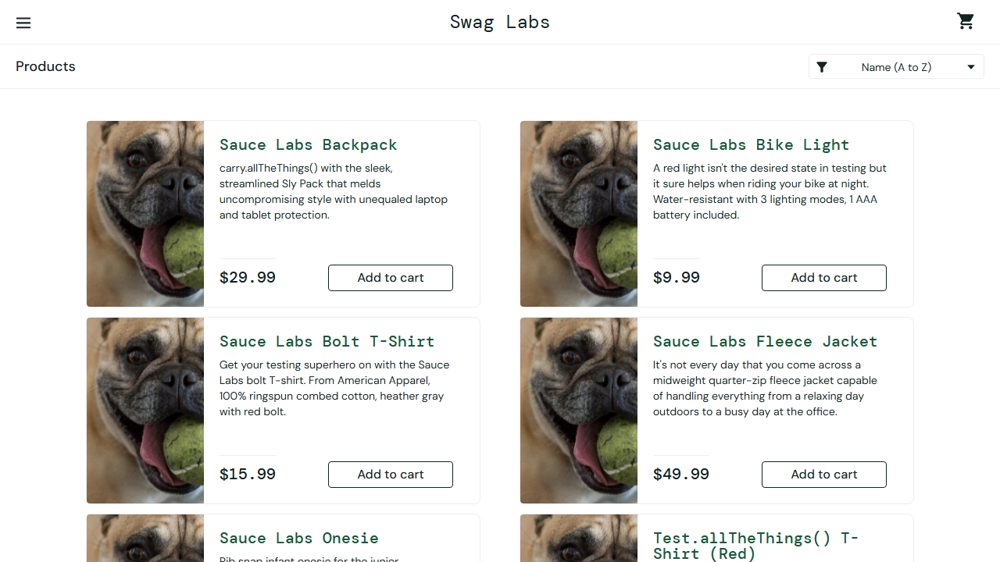
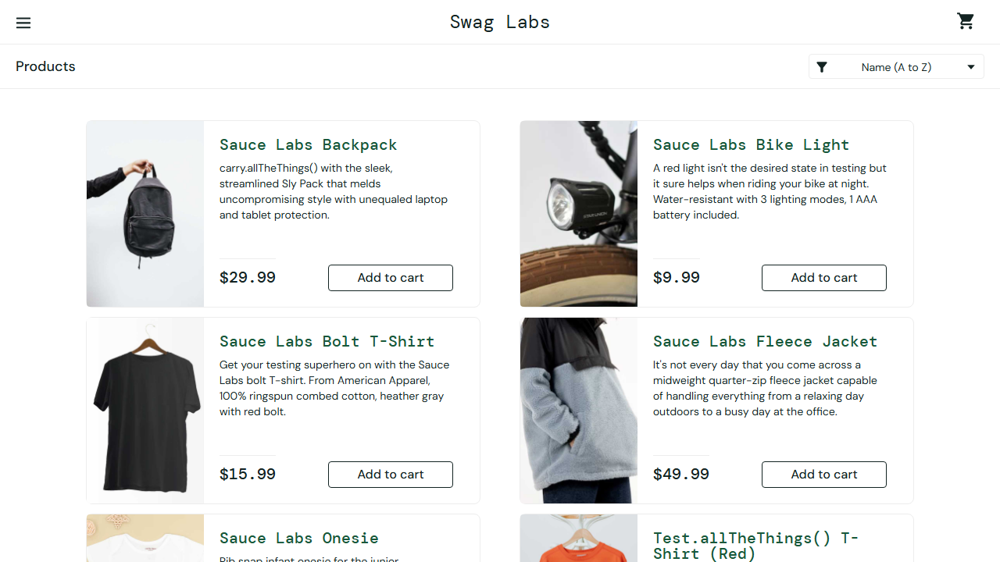

# Relatórios de defeitos

Defeitos encontrados durante a automação. Cada um tem um teste que o reproduz ou o cobre.
Os que reproduzem estão marcados com `test.fail()`: a suíte continua verde enquanto o defeito
existir e avisa quando ele for corrigido.

| ID | Título | Sistema | Severidade | Prioridade | Status |
|---|---|---|---|---|---|
| BUG-01 | Login com senha inválida retorna HTTP 200 | Restful-Booker API | Média | Média | Aberto |
| BUG-02 | Exclusão de reserva retorna HTTP 201 | Restful-Booker API | Baixa | Baixa | Aberto |
| BUG-03 | Todos os produtos exibem a mesma imagem para o problem_user | SauceDemo | Média | Alta | Aberto |

---

## BUG-01: Login com senha inválida retorna HTTP 200

- **Ambiente:** https://restful-booker.herokuapp.com
- **Endpoint:** `POST /auth`
- **Teste que reproduz:** `API09` em `tests/api/booking.spec.ts`

**Passos para reproduzir**
1. Enviar `POST /auth` com o corpo `{"username": "admin", "password": "senha_errada"}`.

**Resultado esperado:** status **401 Unauthorized**, indicando falha de autenticação.

**Resultado obtido:** status **200 OK** com o corpo `{"reason": "Bad credentials"}`.

**Impacto:** quem consome a API precisa ler o corpo da resposta para saber se o login falhou.
Integrações que confiam apenas no status code tratam o erro como sucesso.

---

## BUG-02: Exclusão de reserva retorna HTTP 201

- **Ambiente:** https://restful-booker.herokuapp.com
- **Endpoint:** `DELETE /booking/{id}`
- **Teste relacionado:** `API07` em `tests/api/booking.spec.ts`

**Passos para reproduzir**
1. Criar uma reserva com `POST /booking` e guardar o `bookingid`.
2. Gerar um token com `POST /auth`.
3. Enviar `DELETE /booking/{bookingid}` com o header `Cookie: token={token}`.

**Resultado esperado:** status **200 OK** ou **204 No Content**.

**Resultado obtido:** status **201 Created**, código que indica criação de recurso.

**Impacto:** baixo. A exclusão acontece (o `GET` seguinte retorna 404), mas o código está
semanticamente errado e pode confundir quem integra com a API.

---

## BUG-03: Todos os produtos exibem a mesma imagem para o problem_user

- **Ambiente:** https://www.saucedemo.com, navegador Chromium (desktop)
- **Usuário:** `problem_user` / `secret_sauce`
- **Teste que reproduz:** `CT12` em `tests/e2e/imagens.spec.ts`

**Passos para reproduzir**
1. Acessar https://www.saucedemo.com.
2. Fazer login com `problem_user` / `secret_sauce`.
3. Observar a lista de produtos.

**Resultado esperado:** cada um dos 6 produtos exibe a própria foto, como acontece com o `standard_user`.

**Resultado obtido:** os 6 produtos exibem a mesma foto (um cachorro), que não corresponde a nenhum deles. Os 6 elementos `` apontam para o mesmo
arquivo (`/assets/sl-404-....jpg`).

**Evidências**

| Com defeito (problem_user) | Referência correta (standard_user) |
|---|---|
|  |  |

**Impacto:** o cliente não vê a foto real do produto que está comprando, o que afeta diretamente a conversão da loja.
